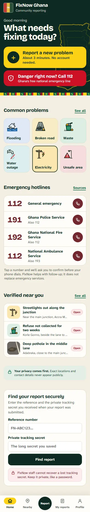
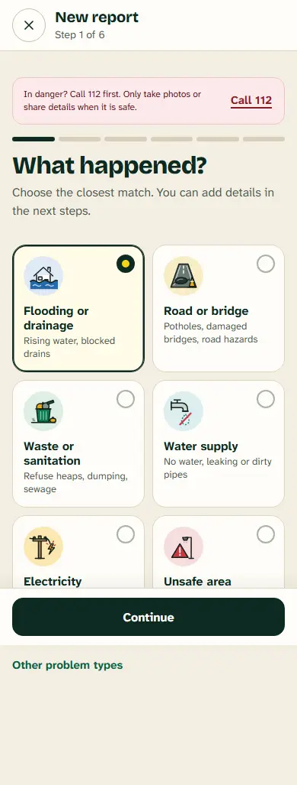
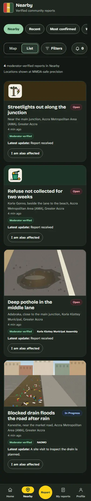
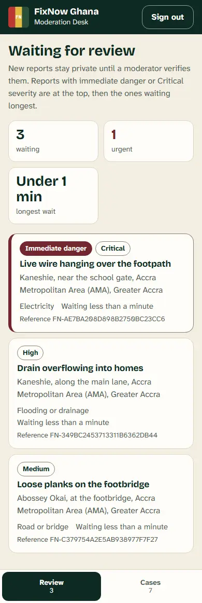

# FixNow Ghana

**[Try the live demo](https://robertrese.github.io/fixnow-ghana/)** (sample data; nothing you enter is sent anywhere), or **[see every screen](https://robertrese.github.io/fixnow-ghana/screens/)**

FixNow Ghana is an offline-first civic reporting app. Residents report flooding, damaged roads, waste, water, electricity and safety problems. Moderators check each report before it appears publicly, and authorised responders see exact locations only for cases routed to their own office.

<p>
  
  
  
  
</p>
<p><em>Screens shown with demo data.</em></p>

It is **not pilot-ready yet**. Only the demo is online; the real service has not been deployed, and the live map, SMS sign-in codes and production hosting still need the owner's accounts (see "Before a pilot").

## Source of truth

- `outputs/` contains the web app (`fixnow-ghana.html`), its service worker, illustrations, public policy and support pages, and the front-end tests.
- `work/fixnow-backend/` contains the Node.js API (SQLite) and its integration test.
- `work/fixnow-android/` contains the Android WebView wrapper source. Its generated web assets and build outputs are excluded.
- `work/fixnow-ops/` contains deployment and operational documentation.
- `outputs/fonts/` contains the two bundled typefaces, Bricolage Grotesque and Atkinson Hyperlegible Next, with their SIL Open Font License files.
- `design/v2-handoff/` contains the redesign brief, artwork, reference frames, screenshots and build notes.

Generated Android builds, runtime databases, WAL/SHM files, test data, logs, release artifacts, and all signing material are intentionally ignored. Do not place secrets in this repository. The existing signing material under `work/fixnow-secrets/` is retained locally until the owner confirms a secure backup; it must never be committed or packaged into source archives.

## How it behaves today

- Emergency numbers (112; Police 191; Fire 192; Ambulance 112 or 193) are one tap from Home, and every call asks for confirmation before the phone dialler opens.
- A report takes six steps: problem, place, description, photos, contact, review. Contact details, photos and exact GPS are optional.
- Without a connection, a report is saved on the phone and sent automatically once the phone is back online with the app open. The app says "Saved and waiting to send" until the server confirms the report, and only then shows a reference number and private tracking secret.
- The public feed shows only moderator-verified reports, at an approximate location. A photo appears publicly only after a moderator marks it clean and confirms that no faces, number plates or house numbers are visible. The server re-writes each published photo without its metadata.
- Demo mode is explicitly enabled with `?demo=1`; it uses separate browser storage and sends nothing. In demo mode the 112 and hotline buttons show the number and the advice to dial 112 from a phone, without opening the dialler, and staff sign-in points to the screen gallery.
- Staff work in a separate page (`outputs/staff.html`). Responders see a report only after a moderator verifies or escalates it and it is routed to their own office, or when it is assigned to them.

## Public demo and screen gallery

- **Demo app:** `docs/` is a generated copy of the app that is always in demo mode, with a browser rule that blocks connections to any other server. Build it with `npm run build:demo` and check it with `node work/qa/demo-check.js`. GitHub Pages serves it from the `docs` folder of `main`.
- **Screen gallery:** every resident and staff screen, phone and laptop, light and dark, in `design/screens` ([README](design/screens/README.md)), and on the demo site at `/screens/`. Rebuild with `npm run gallery`.

GitHub Pages serves the demo site from the `docs/` folder of `main`.

## Local checks

```powershell
npm run check
```

This runs the syntax checks, the front-end policy and phase tests, and the backend integration test. The local API, demo data, screenshots and accessibility checks are described in `work/qa/README.md`. `CLAUDE.md` is the working guide for contributors and AI coding assistants.

## Before a pilot

- Deploy the API behind HTTPS, with production values in a secret manager rather than a checked-in `.env` file. See `work/fixnow-backend/.env.example` for the variable names.
- Add a restricted Google Maps browser key and Map ID for the live map. Without them, Nearby shows the list of verified reports.
- Connect an SMS (OTP) provider for optional citizen accounts.
- Rebuild and sign the Android app after web changes (see `work/fixnow-android/README.md`).
- **Make sure urgent reports are not slowed down by moderation.** Responders now see a report only after a moderator verifies or escalates it, so:
  - nothing reaches an office until a moderator acts. Urgent reports are first in the review queue and Escalate releases them at once, but nights and weekends need a moderator rota, or an alert for urgent reports, which is not built yet;
  - a report that no routing rule matches reaches no office after verification (moderators see a "No office can see this" warning and can assign it by hand). Add a catch-all routing rule for every district;
  - offices are matched to staff accounts by the office name, so a mistyped office name means that account sees nothing. Link staff accounts to offices by ID;
  - when a case is moved to another office, the first office loses access unless the case is assigned to someone there. Agree how hand-overs work.
